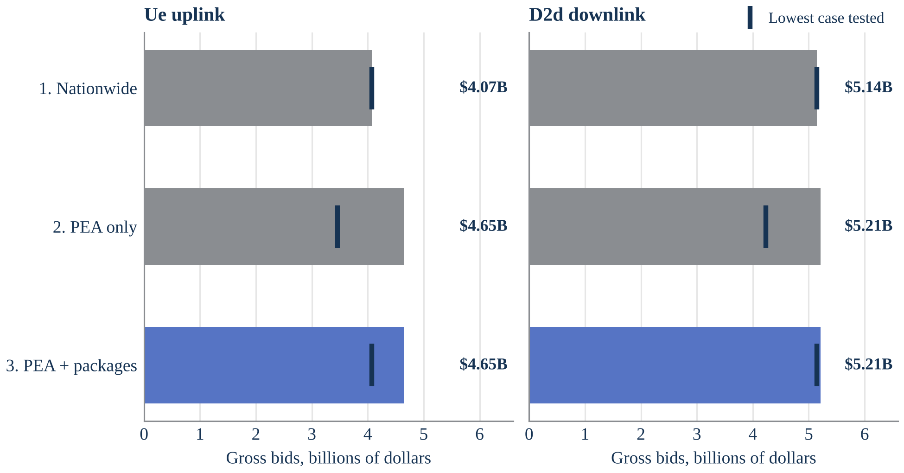
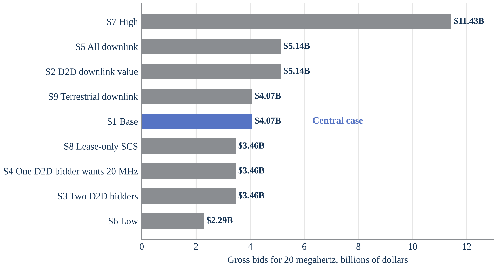
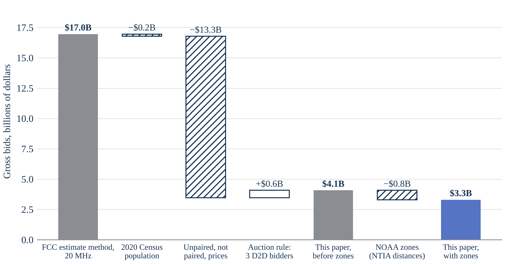
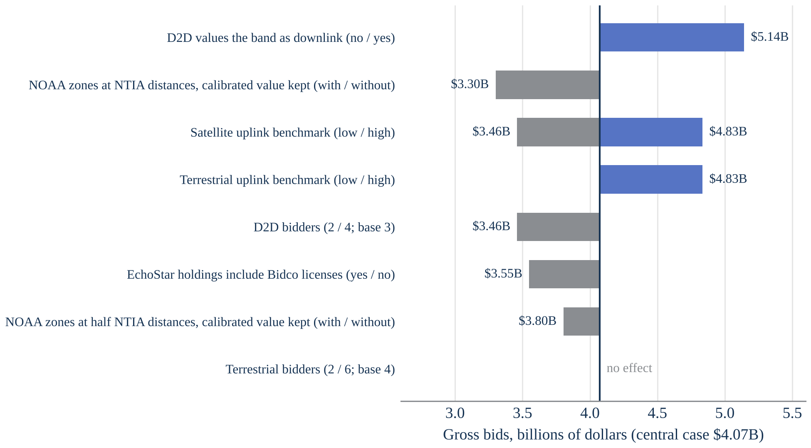
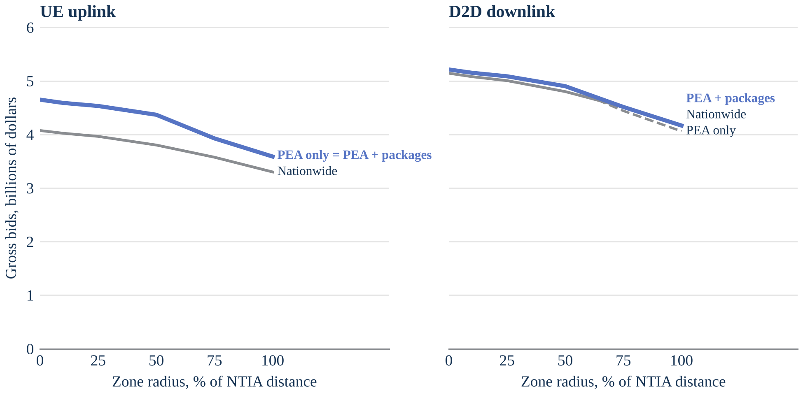
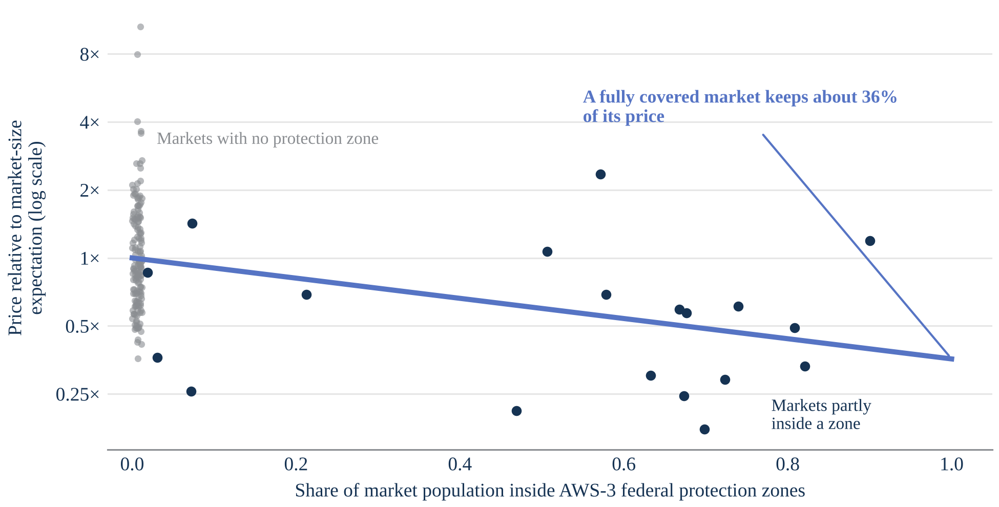

**DRAFT//PRE-DECISIONAL**

# Estimating Auction Revenue for 20 Megahertz at 1675–1695 MHz: Evidence, Method, License Design, and Federal Coordination

Working paper v0.5, November 13, 2026. Prepared with AI assistance. Reviewer: [CONFIRM]. Rule text as of: FCC 26-70, adopted October 29, 2026.

All dollar figures are **gross bids** for the two 10-megahertz blocks at 1675–1695 MHz. The 2020–2025 MHz block in the same proposal is out of scope. Figures marked "before coordination" exclude the four National Oceanic and Atmospheric Administration (NOAA) coordination zones; section 6 adds them.

## Executive summary

- **Central estimate: $4.1 billion before coordination; about $3.3 billion with NOAA zones at NTIA's distances.** A simulation puts the middle 80 percent of pre-coordination outcomes between $3.3 and $4.5 billion.
- **The FCC's own estimate is about four times higher.** Its regulatory impact analysis applies the Auction 113 average price, $2.53 per megahertz-pop, which is mostly paired spectrum. Unpaired spectrum at 1695–1710 MHz sold for $0.52. That one choice accounts for $13.3 billion of the gap (Figure 6).
- **The number of D2D bidders matters most among things we can't observe.** With three or more independent direct-to-device (D2D) bidders, they set the price; with two or fewer, revenue falls to $3.46 billion. The number of terrestrial bidders doesn't change the central estimate (Figures 7 and 8).
- **NTIA's coordination distances would put 30 percent of the U.S. population inside a NOAA zone.** Calibrated on how AWS-3 protection zones lowered Auction 97 prices, the zones cut revenue by $0.3 billion at half NTIA's distances and $0.8 billion at full distances (Figures 9–11).
- **Partial Economic Area (PEA) licenses with nationwide package bids hold value best.** They match or beat nationwide and PEA-only licensing in every case tested, with and without zones, provided at least three D2D bidders compete for packages (Figures 3 and 10).

## 1. The question

The FNPRM proposes two unpaired 10-megahertz blocks, 1675–1685 MHz and 1685–1695 MHz, plus a 5-megahertz block at 2020–2025 MHz (para. 48).[1] Licensees could use the spectrum for uplink, downlink, or time-division duplex (para. 52), with a secondary mobile-satellite allocation for supplemental coverage from space (SCS) (paras. 30–34). The Commission seeks comment on nationwide, Regional Economic Area Grouping (REAG), or PEA licenses, or different sizes by block (paras. 43–44, 51); on bundling and all-or-nothing nationwide package bids (paras. 75–78); and on coordination zones around four NOAA Data Collection System (DCS) receive sites (paras. 101–102).

This paper asks what the 20 megahertz at 1675–1695 MHz could raise, which license design raises the most, and how much the NOAA zones cost.

## 2. Related literature

Bazelon and McHenry conclude that market sales are the starting point for valuing spectrum but need adjustment, and that one valuation technique leaves information unused.[6] Budget estimates are coarser: the Congressional Budget Office scored the P.L. 119-21 auctions at $85.0 billion without valuing bands one by one,[7] and Arner and Furchtgott-Roth applied megahertz-pop benchmarks with a 50 to 80 percent discount for limiting factors, including federal protection.[8] The FCC's own estimate for this proceeding applies one average price with a ±50 percent range.[1]

For AWS-3, Cramton and Sujarittanonta report the $2.72 paired and $0.52 unpaired prices that this paper reproduces, and show that prices rose with market size.[3] Work on the PCS auctions found geographic synergies[9] and that larger regional licenses would have raised efficiency,[10] which supports the national premium and the D2D exposure discount used here. Hazlett and Muñoz caution that revenue alone is a poor guide to allocation policy.[11] The pricing rule follows the theory of demand reduction in multi-unit auctions[12] and of package bidding and core pricing.[13]

This search found no published estimate of how much federal protection areas lower auction prices. Section 6 provides one, from the adjacent band's own auction. The full review is in `docs/literature-review.md`.

## 3. Evidence

**Auction 97 unpaired spectrum.** The FCC's Auction 97 results and inventory give a price for every license.[2] The paper parses all 1,614 licenses and reconciles them exactly to the published $41,329,673,325 in net bids and 1,611 licenses won. The unpaired 1695–1710 MHz blocks sold for $0.52 per megahertz-pop; the 10-megahertz B1 block sold for $0.73. Paired spectrum sold for $2.71, about five times the unpaired price.

**Market size.** Across 174 sold B1 licenses, the slope of log price on log population is 0.65 (R² = 0.59) (Figure 2). Large markets paid more per person, which is why PEA licensing can raise more than one national price.

**Auction 113.** The 2026 auction raised $3,572,889,200 gross across 200 licenses, an average of $2.53 per megahertz-pop.[2] Only two licenses were unpaired; SpaceX won B1 in Cincinnati at $0.35. Across 196 licenses sold in both auctions, 2026 price per person was 0.99 times the 2015 price, which supports applying 2015 prices to current population.

**Transactions.** SpaceX agreed to buy EchoStar's unpaired AWS-3 licenses for about $2.6 billion in stock;[4] adjusted for the 85 percent of population those licenses cover, that is $0.61 per megahertz-pop, 1.21 times the 2015 market-by-market price of the same licenses. For D2D downlink, the Grain 800 MHz spectrum was once on the market for $3.6 billion ($0.78) and reportedly sold to SpaceX for $8 billion ($1.72).[5]

**Unpaired downlink.** Two comparables restore terrestrial downlink, the use NTIA studied:[14]
- Qualcomm sold its unpaired Lower 700 MHz D and E Block licenses to AT&T for $1.925 billion for supplemental downlink. The FCC's approval order lists six megahertz nationwide and six more in five large Economic Areas; with 2010 populations, that is $0.84 per megahertz-pop.[15] It is low-band spectrum, so it is the ceiling.
- Crown Castle leased the adjacent 1670–1675 MHz nationwide license for $13 million a year in 2007.[16] Capitalized at the 7 percent rate the FCC uses (FNPRM App. C), that is $0.12 per megahertz-pop. It is the floor. The 2003 auction price for that license couldn't be retrieved from FCC records here.

Only the Qualcomm terms are verified in a primary filing. The other transaction terms come from releases and press reports and are flagged PENDING in the workbook.

## 4. Method

**Benchmarks.** Each use has a low, base, and high price (Figure 1):

| Use | Low | Base | High |
| --- | --- | --- | --- |
| Terrestrial uplink | $0.18 (B1 25th percentile) | $0.52 (Auction 97 unpaired) | $0.73 (B1) |
| Terrestrial downlink | $0.12 (1670–1675 lease) | $0.48 (average of the two) | $0.84 (Qualcomm 700 MHz) |
| Satellite uplink | $0.35 (Auction 113 B1) | $0.61 (EchoStar) | $0.73 (B1) |
| D2D downlink | $0.61 (EchoStar) | $0.78 (Grain prior market) | $1.72 (Grain to SpaceX) |

**Bidders.** The model uses counts, not a named list: three D2D bidders and four terrestrial bidders in the base case, varied from zero to six in section 5.2.

**Pricing.** With two blocks in a uniform-price clock auction, the price per block is the highest losing bid, the third-highest bid. One D2D bidder may want both blocks; it bids for two only if that leaves it more surplus (demand reduction). Revenue is the price times two blocks.

**License areas.** Under PEA licensing, each of 406 contiguous PEAs plus a combined Alaska and Hawaii market is its own auction. Terrestrial values by PEA follow the fitted market-size curve; D2D per-PEA bids lose the 1.21 national premium. With package bidding, a nationwide package wins a block only if it beats the sum of the per-PEA bids, and pays at least that sum.

**Coordination zones.** Each county's 2020 population-weighted center is inside a zone if it lies within the coordination distance of one of the four sites. NTIA's distances (Fairmont 459 km, Sioux Falls 346 km, Suitland 468 km, Wallops 446 km) come from its 2024 study, which NTIA calls conservative.[17] Zones are scaled from 0 to 100 percent of those distances. Population inside a zone keeps a fraction of its value, calibrated in section 6.2.

**Independent implementation.** A separate Python implementation recomputes the benchmarks from the FCC data and reproduces every workbook scenario and license-design result to within one cent before it runs the sections 5 and 6 analyses.

## 5. Results before coordination

### 5.1 Central estimate and range

The central case (three D2D bidders valuing the band as satellite uplink) raises $4.07 billion. If D2D bidders value it as downlink, $5.14 billion. With two D2D bidders, or if D2D operators lease SCS rights instead of bidding, $3.46 billion. If terrestrial bidders value it as downlink, revenue doesn't change, because D2D bidders still set the price. The low and high benchmark cases bracket the result at $2.29 and $11.43 billion (Figure 4); the high case rests on a low-band price.

### 5.2 Number of bidders

The point estimate steps from $3.46 billion to $4.07 billion (uplink value) or $5.14 billion (downlink value) when a third D2D bidder enters. In the simulation, which spreads each bidder's value, the median rises smoothly from $3.21 billion with no D2D bidders to $3.87 billion with three and $4.27 billion with six (Figure 7). Varying terrestrial bidders from two to six doesn't change the central estimate.

### 5.3 Why the FCC's estimate is higher

The FCC estimates $21.2 billion for all 25 megahertz ($10.6 to $31.8 billion), using the Auction 113 average of $2.53 per megahertz-pop.[1] The FCC data reproduce that average ($2.527). Scaled to 20 megahertz, the FCC method gives $17.0 billion. Moving to the 2020 Census population subtracts $0.2 billion; pricing unpaired spectrum at the unpaired price subtracts $13.3 billion; the auction rule with three D2D bidders adds $0.6 billion; NOAA zones at NTIA's distances subtract $0.8 billion, leaving $3.3 billion (Figure 6). Paired licenses were 98 percent of the megahertz-pops sold in Auction 113, and paired spectrum sold for five times unpaired spectrum in Auction 97.

### 5.4 License design

Gross bids before coordination, billions of dollars:

| Design | UE uplink | D2D downlink | Lowest case tested (uplink / downlink) |
| --- | --- | --- | --- |
| 1. Nationwide | 4.07 | 5.14 | 4.07 / 5.14 |
| 2. PEA only | 4.65 | 5.21 | 3.46 / 4.24 |
| 3. PEA with nationwide packages | 4.65 | 5.21 | 4.07 / 5.14 |

Terrestrial bidders win the 13 largest PEAs under PEA licensing, and D2D bidders win the rest. PEA-only licensing loses its advantage if price per person is flat across market sizes or if D2D bidders discount for exposure risk; package bids cover that weakness (Figure 3).

### 5.5 Stress tests

- **Package bids need D2D competition.** With three or more D2D bidders, packages are safe. With one or two, a package can win at the local bidders' price; if local bidders mount only 80 percent of their combined value (the threshold problem), revenue falls from $3.46 billion to $2.77 billion.
- **Adjacency and demand reduction.** An adjacency premium alone doesn't change the price, because the third-highest bid sets it. It matters only if it makes the holder bid for both blocks. With two D2D bidders, that happens when the lead values the second block at 1.2 times the first and holds a premium of 21 percent or more, or holds a premium of 50 percent; revenue then rises from $3.46 billion to $5.14 billion.
- **Income check.** At the FCC's 7 percent rate over the proposed 15-year term (para. 56), the central price implies $1.35 per person per year for 20 megahertz, about 11 cents a month; the D2D downlink price implies $1.70 a year.

### 5.6 Backtest

Fitting the market-size curve on random halves of the Auction 97 B1 licenses and predicting the other half gives a median error of 49 percent per license, against 401 percent for one national price. The error in total hold-out revenue has a median of 0.2 percent (10th to 90th percentile: −24 to +30 percent). Out of sample, the 2015 curve predicted SpaceX's 2026 Cincinnati B1 price within 19 percent; it missed the one 5-megahertz A1 license by 79 percent.

## 6. Federal coordination

### 6.1 How far the zones reach

The zone model reproduces NTIA's own population results for the 25 largest PEAs to within 0.1 percentage point on average, and agrees on all 25. At NTIA's distances, the four zones cover 30 percent of the U.S. population, including nearly all of the New York, Baltimore–Washington, Philadelphia, Cleveland, and Pittsburgh PEAs. At half those distances they cover 10 percent; at a quarter, 4 percent (Figure 9).

### 6.2 What a zone costs: evidence from AWS-3

The adjacent 1695–1710 MHz licenses sold in Auction 97 with 27 federal earth station protection zones (47 CFR 2.106, footnote US88). Regressing each B1 license's log price on log population and the share of its population inside a zone (172 markets, 19 with zones) gives a coefficient of −1.03 (standard error 0.24). A fully covered market sold for about 36 percent of the market-size expectation (95 percent range: 22 to 57 percent) (Figure 11). Dropping Baltimore–Washington strengthens the effect (−1.20); an any-zone indicator gives prices 49 percent lower. The estimate rests on 19 markets, mostly partly covered, and on a bidder pool dominated by Dish-affiliated entities, so it is a calibration, not a precise measurement.

### 6.3 Revenue with zones

With 36 percent of value kept inside zones:

| Zone radius | UE uplink: nationwide / PEA + packages | D2D downlink: nationwide / PEA + packages |
| --- | --- | --- |
| None | $4.07B / $4.65B | $5.14B / $5.21B |
| Half NTIA distance | $3.80B / $4.37B | $4.80B / $4.90B |
| NTIA distance | $3.30B / $3.59B | $4.17B / $4.17B |

PEA licenses with packages stay at or above the other designs at every radius (Figure 10). Under PEA-only licensing, large zones hurt downlink revenue more than nationwide licensing does, because terrestrial bidders lose the large Northeast markets they would otherwise win.

## 7. Limitations

- **Zone size.** NTIA calls its distances conservative, and the FCC asks whether deployment-based assumptions should replace them (para. 102). The result spans half to full NTIA distances; smaller zones cost less.
- **Zone cost calibration.** It comes from 19 partly covered AWS-3 markets and applies the same retained share to terrestrial and D2D use.
- **Bidder counts.** The headline assumes three D2D bidders. With two, the point estimate falls by $0.6 billion.
- **Transactions.** EchoStar, Grain, and the 1670–1675 MHz lease are from releases and press reports; only the Qualcomm sale is verified in an FCC order.
- **Not modeled.** 2020–2025 MHz, REAG licenses, alternative band plans, bidding credits, and timing.

## 8. Reproducing this paper

`./reproduce.sh` downloads or checks every source file, parses it, builds and recalculates the workbook, verifies it, exports every dataset to `data/csv/`, runs the independent analyses, and rebuilds every figure.

| Item | Location |
| --- | --- |
| Workbook | `outputs/1675-auction-valuation-v0.5.xlsx` |
| Datasets | `data/csv/` (descriptions in `data/csv/README.md`) |
| Analyses | `scripts/analysis.py` |
| Figure code | `scripts/make_figures.py`, `scripts/briefing.mplstyle` |
| Figures (PNG, SVG, PDF) | `figures/` |
| Visualization plan | `docs/dataviz-plan.md` |
| Literature review | `docs/literature-review.md` |
| Plan | `docs/next-phase-plan.md` |

## Numbers ledger

| Figure | Exact value | Source file | Rounded form |
| --- | --- | --- | --- |
| Central case (S1) | $4,073,638,216 | `scenarios.csv` | $4.07 billion ($4.1 billion in summaries) |
| D2D downlink value (S2) | $5,142,857,143 | `scenarios.csv` | $5.14 billion |
| Two D2D bidders or SCS lease (S3, S8) | $3,460,286,484 | `scenarios.csv` | $3.46 billion |
| Low and high cases (S6, S7) | $2,291,684,702; $11,428,571,429 | `scenarios.csv` | $2.29 and $11.43 billion |
| PEA (+ packages), uplink and downlink | $4,649,631,172; $5,212,968,610 | `license_area_results.csv` | $4.65 and $5.21 billion |
| Simulated 10th percentile, median, 90th | $3.33, $3.89, $4.50 billion | `monte_carlo_draws.csv` | same |
| FCC estimate, 25 and 20 MHz | $21.19 and $16.96 billion | `fcc_ria_comparison.csv` | $21.2 and $17.0 billion |
| Population inside zones at NTIA, half distance | 29.5%, 10.3% | `zone_sweep.csv` | 30%, 10% |
| Value kept in a fully covered market | 35.7% (22.4–57.0%) | `analysis_summary.csv` | 36% |
| Central case with zones at NTIA, half distance | $3,300 million; $3,803 million | `tornado.csv` | $3.3 and $3.8 billion |
| Qualcomm 700 MHz; 1670–1675 lease | $0.842; $0.120 per MHz-pop | `transactions.csv` | $0.84; $0.12 |

## Figures

Captions and alternative text. The images carry no title, so they can take a report's own captions.

**Figure 1. Benchmark prices by use.** Price per megahertz-pop; bars show low to high, dots the base case. Source: FCC Auctions 97 and 113, FCC 11-188, and reported transactions (`data/csv/benchmarks.csv`).

**Figure 2. In Auction 97, price per person rose with market size.** 174 B1 licenses; fitted slope 0.65; log axes. Source: FCC DA 15-131 (`a97_unpaired_licenses.csv`).

**Figure 3. PEA licenses with package bids match or beat the other designs.** Bars are base-case gross bids; ticks mark the lowest case tested. Source: workbook v0.5 (`license_area_results.csv`).

**Figure 4. Scenario results before coordination.** Source: workbook v0.5 (`scenarios.csv`).

**Figure 5. Simulated gross bids center near $3.9 billion.** 10,000 draws, seed 1675; three D2D and four terrestrial bidders. Source: `monte_carlo_draws.csv`.

**Figure 6. The FCC's estimate is higher mainly because it prices unpaired spectrum like paired spectrum.** Bridge from the FCC's method scaled to 20 megahertz to this paper's estimate with zones. Source: FNPRM App. C and `fcc_ria_comparison.csv`, `tornado.csv`.

**Figure 7. A third D2D bidder raises the point estimate; the simulated median rises steadily.** Four terrestrial bidders; band is the 10th to 90th percentile of 2,000 draws per point. Source: `bidder_count_grid.csv`.

**Figure 8. D2D valuation, NOAA zones, and the satellite benchmark move the central estimate most.** One input at a time from the $4.07 billion central case. Source: `tornado.csv`.

**Figure 9. At NTIA's distances, the four NOAA zones would cover 30 percent of the population.** Counties whose population center is within the coordination distance. Source: NTIA Report 24-01, Census 2020 (`zone_counties.csv`).

**Figure 10. PEA licenses with packages hold value best as zones grow.** Revenue by zone radius, with 36 percent of value kept inside zones. Source: `zone_sweep.csv`.

**Figure 11. AWS-3 protection zones lowered Auction 97 prices.** Price relative to the market-size expectation against the share of population inside 47 CFR 2.106 US88 zones; line is the regression fit. Source: `aws3_zone_calibration.csv`.

## Sources

1. FCC, *Auctioning the 1675-1695 MHz and 2020-2025 MHz Bands*, Further Notice of Proposed Rulemaking, FCC 26-70, WT Docket No. 26-284 (adopted Oct. 29, 2026), paras. 30–34, 43–56, 75–78, 101–102, and App. C ([FCC](https://docs.fcc.gov/public/attachments/FCC-26-70A1.pdf)).
2. FCC, [DA 15-131](https://docs.fcc.gov/public/attachments/DA-15-131A2.pdf) and [DA 14-1018](https://docs.fcc.gov/public/attachments/DA-14-1018A2.pdf) (Auction 97); [DA 26-633](https://docs.fcc.gov/public/attachments/DA-26-633A1.pdf) and [Auction 113 results by license](https://auctiondata.fcc.gov/public/projects/auction113/reports/results_by_license); [DA 14-759](https://docs.fcc.gov/public/attachments/DA-14-759A3.pdf) (PEA definitions). Checksums in `data/SOURCES.md`.
3. Peter Cramton and Pacharasut Sujarittanonta, "Bidding and Prices in the AWS-3 Auction" (May 2015) ([copy](https://www.mintic.gov.co/portal/historico/articles-103102_avantel_anexo_d_3_cramtonaws3auctionprices.pdf)).
4. [EchoStar release, Nov. 6, 2025](https://ir.echostar.com/news-releases/news-release-details/echostar-agrees-sell-full-unpaired-aws-3-spectrum-license).
5. [Fierce Network on SpaceX and Grain](https://www.fierce-network.com/wireless/spacexs-800-mhz-spectrum-grab-threatens-big-3-mobile-carriers); the $8 billion figure is as reported by the Wall Street Journal.
6. Coleman Bazelon and Giulia McHenry, "Spectrum value," *Telecommunications Policy* 37(9) (2013): 737–747 ([RePEc](https://econpapers.repec.org/RePEc:eee:telpol:v:37:y:2013:i:9:p:737-747)).
7. CBO, supplemental cost estimate for P.L. 119-21, Sec. 40002 (Oct. 28, 2025) ([CBO](https://www.cbo.gov/system/files/2025-10/PL%20119-21-Spectrum.pdf)).
8. Kirk R. Arner and Harold Furchtgott-Roth, "Estimated Value of Potential Spectrum Auction Receipts in the Next Five-Year Window," Hudson Institute (July 18, 2024) ([Hudson](https://hudson.org/technology/estimated-value-potential-spectrum-auction-receipts-next-five-year-window-kirk-arner-harold-furchtgott-roth)).
9. Ausubel, Cramton, McAfee, and McMillan, "Synergies in Wireless Telephony," *Journal of Economics & Management Strategy* 6(3) (1997): 497–527.
10. Jeremy T. Fox and Patrick Bajari, "Measuring the Efficiency of an FCC Spectrum Auction," *American Economic Journal: Microeconomics* 5(1) (2013): 100–146.
11. Thomas W. Hazlett and Roberto E. Muñoz, "A welfare analysis of spectrum allocation policies," *RAND Journal of Economics* 40(3) (2009): 424–454.
12. Ausubel, Cramton, Pycia, Rostek, and Weretka, "Demand Reduction and Inefficiency in Multi-Unit Auctions," *Review of Economic Studies* 81(4) (2014): 1366–1400.
13. Goeree and Holt, "Hierarchical package bidding," *Games and Economic Behavior* 70(1) (2010): 146–169; Day and Milgrom, "Core-selecting package auctions," *International Journal of Game Theory* 36 (2008): 393–407.
14. NTIA, letter to FCC Chairman Brendan Carr identifying 1675–1680 MHz (Feb. 26, 2026) ([NTIA](https://www.ntia.gov/sites/default/files/2026-03/1675-mhz-identification-letter.pdf)).
15. FCC, *Application of AT&T Inc. and Qualcomm Incorporated*, Order, FCC 11-188 (Dec. 22, 2011), paras. 1, 15 ([FCC](https://docs.fcc.gov/public/attachments/FCC-11-188A1.pdf)).
16. [TV Technology, "Crown Castle Leasing Modeo Spectrum for $13 Million Per Year" (July 27, 2007)](https://www.tvtechnology.com/news/crown-castle-leasing-modeo-spectrum-for-13-million-per-year).
17. NTIA Report 24-01, *Spectrum Pipeline Reallocation Engineering Study Follow-On* (Dec. 2024), Tables 3, 9, and 11 ([NTIA](https://www.ntia.gov/sites/default/files/2025-10/ntia_report_24-01_12-2024-1675mhz-rev3-ntia-spres-fo.pdf)); 47 CFR 2.106(c)(88) (eCFR, Nov. 1, 2026).

**DRAFT//PRE-DECISIONAL**
