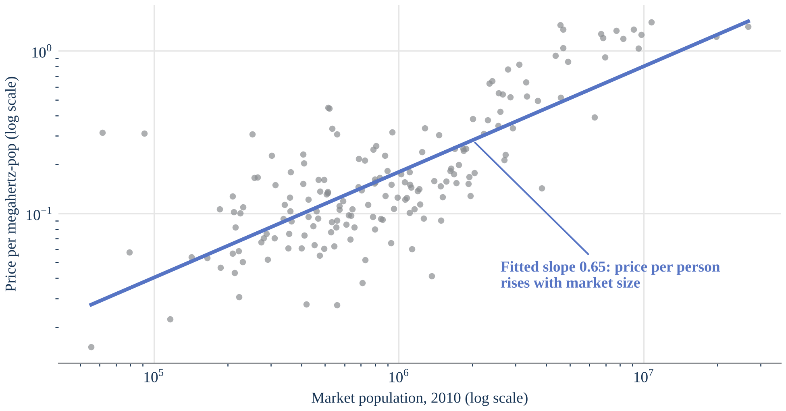

**DRAFT//PRE-DECISIONAL**

# Estimating Auction Revenue for 20 Megahertz at 1675–1695 MHz: Evidence, Method, and License-Design Effects

Working paper, November 13, 2026. Prepared with AI assistance. Reviewer: [CONFIRM]. Rule text as of: November 13, 2026 (summary of the FNPRM draft; adopted text not yet reviewed).

Every dollar figure in this paper is a **gross bid before federal coordination, and an upper bound**. The four National Oceanic and Atmospheric Administration (NOAA) Data Collection System receive-site zones aren't modeled yet.

## Abstract

The Federal Communications Commission (FCC) proposes to auction two unpaired 10-megahertz blocks at 1675–1695 MHz (Further Notice of Proposed Rulemaking (FNPRM), FCC 26-70, WT Docket No. 26-284).[1] This paper estimates what the auction could raise and how the answer depends on license design. Benchmarks come from the FCC's own data: Auction 97 (2015) unpaired prices at 1695–1710 MHz, Auction 113 (2026), and the SpaceX purchases of EchoStar and Grain spectrum. A two-block uniform-price clock auction model prices the blocks at the highest losing bid.

The central estimate is $4.07 billion, with a range of $2.29 to $11.43 billion across benchmark cases. A Monte Carlo run puts the middle 80 percent of outcomes between $3.33 and $4.50 billion. License design moves the answer by about $0.6 to $0.9 billion. Partial Economic Area (PEA) licenses with nationwide package bids raise at least as much as the better of the other two designs in every case tested. Every estimate depends on three or more independent direct-to-device (D2D) bidders. With two or fewer, all designs raise about $3.46 billion.

## 1. The question

The FNPRM proposes two unpaired 10-megahertz blocks, 1675–1685 MHz and 1685–1695 MHz. Licensees could choose uplink, downlink, or time-division duplex, and a secondary mobile-satellite allocation would support supplemental coverage from space (SCS). The Commission seeks comment on nationwide, regional, or PEA licenses and on nationwide package bids.[1]

Two questions follow. First, what could 20 megahertz raise, given what comparable spectrum has sold for? Second, which license design raises the most, and how robust is that result?

## 2. Related literature

Bazelon and McHenry conclude that market sales are the starting point for valuing spectrum but
need adjustment, and that relying on one valuation technique leaves information unused.[6] Budget
estimates are coarser: the Congressional Budget Office scored the P.L. 119-21 auctions at
$85.0 billion without valuing bands one by one,[7] and Arner and Furchtgott-Roth applied
megahertz-pop benchmarks with a 50 to 80 percent discount for limiting factors, including federal
protection.[8] This paper uses the same benchmark approach but rebuilds the benchmarks from FCC
per-license data and adds an explicit clearing rule.

For AWS-3, Cramton and Sujarittanonta report the $2.72 paired and $0.52 unpaired prices that this
paper reproduces, and show that prices rose with market size.[3] Work on the PCS auctions found
geographic synergies[9] and that larger regional licenses would have raised efficiency,[10] which
supports the national premium and the D2D exposure discount used here. Hazlett and Muñoz caution
that revenue alone is a poor guide to allocation policy.[11] The pricing rule follows the theory of
demand reduction in multi-unit auctions[12] and of package bidding and core pricing.[13]

Two gaps remain. No published study isolates how much federal coordination areas lower auction
prices, and there is little economic work on what D2D operators pay for spectrum. NTIA's 2026 letter
identifying 1675–1680 MHz recommends per-base-station coordination around four NOAA sites,[14] so
both gaps bear directly on this band. The full review is in `docs/literature-review.md`, and
`docs/next-phase-plan.md` plans the work to close them.

## 3. Evidence

**Auction 97 unpaired spectrum.** The FCC's Auction 97 results (DA 15-131) and inventory (DA 14-1018) give a price for every license.[2] The paper parses all 1,614 licenses and reconciles them to the published totals: $41,329,673,325 in net bids and 1,611 licenses won, both exact. The unpaired 1695–1710 MHz blocks sold for $0.52 per megahertz-pop (A1 and B1 combined; Cramton and Sujarittanonta report the same figure[3]). The 10-megahertz B1 block, the same size as the FNPRM proposal, sold for $0.73. Paired spectrum sold for $2.71, about five times the unpaired price.

**Market size.** Prices per person rose with market population. Across 174 sold B1 licenses, the slope of log price on log population is 0.65 (R² = 0.59) (Figure 2). Large markets paid more per person, which is why PEA licensing can raise more than one national price.

**Auction 113.** The 2026 auction (DA 26-633) raised $3,572,889,200 gross across 200 licenses.[2] Only two licenses were unpaired. SpaceX won one of them, B1 in Cincinnati, at $0.35 per megahertz-pop, its own competitive price for this use. Across 196 licenses sold in both auctions, 2026 price per person was 0.99 times the 2015 price, which supports applying 2015 dollars-per-megahertz-pop to current population.

**Transactions.** SpaceX agreed to buy EchoStar's unpaired AWS-3 licenses for about $2.6 billion in stock.[4] Adjusting for the 85 percent of the 1695–1710 MHz population those licenses cover, that is $0.61 per megahertz-pop. Measured against the 2015 prices of the same licenses, SpaceX paid 1.21 times the market-by-market total for a national footprint. For D2D downlink, the benchmark is the Grain 800 MHz spectrum: $3.6 billion when previously on the market ($0.78) and $8 billion reported for SpaceX ($1.72).[5] The transaction terms come from press releases and reports, not primary filings, and are flagged PENDING in the workbook.

## 4. Method

**Benchmarks by use.** Terrestrial uplink uses the Auction 97 unpaired price ($0.52 base, $0.18 low, $0.73 high). Satellite uplink uses the SpaceX/EchoStar price ($0.61 base, $0.35 low, $0.73 high). D2D downlink uses the Grain prior-market price ($0.78 base, $0.61 low, $1.72 high). Figure 1 shows the ranges.

**Bidders.** SpaceX, Amazon Leo, and AST SpaceMobile bid as D2D operators. AT&T, Verizon, T-Mobile, and Ligado bid as terrestrial operators. A carrier D2D joint venture is a switch, off by default. The bidder list is a modeling choice and hasn't been signed off.

**Pricing.** With two blocks and a uniform-price clock auction, the price per block is the highest losing bid, which is the third-highest bid. SpaceX bids for a second block only if doing so leaves it more surplus (demand reduction); in the scenarios tested it doesn't. Revenue is the price times two blocks.

**License areas.** Under PEA licensing, each of 406 contiguous PEAs plus a combined Alaska and Hawaii row is its own auction. Carrier values by PEA are the base price times a factor that rises with population at the fitted slope. D2D bids lose the 1.21 national-portfolio premium, because a D2D operator that wins only some PEAs has no national footprint. With package bidding, a nationwide package wins a block only if it beats the sum of the per-PEA bids, and it pays at least that sum.

**Simulation.** A Monte Carlo run (seed 1675, 10,000 draws) draws carrier values from a lognormal distribution around the terrestrial uplink base (σ = 0.24, from Auction 97 winners that spent over $1 billion) and D2D values uniformly between SpaceX's Auction 113 price and the Grain prior-market price. The D2D range is a judgment, not evidence.

## 5. Results

### 5.1 Central estimate and range

The central case (S1: all bidders, D2D values the band as uplink) raises $4.07 billion. If D2D operators value the band as downlink, it raises $5.14 billion. With only two D2D bidders, or if D2D operators lease SCS rights instead of bidding, it raises $3.46 billion. The low and high benchmark cases bracket the result at $2.29 and $11.43 billion (Figure 4). The high case rests on SpaceX's Grain price for 800 MHz low-band spectrum, which likely overstates 1.7 GHz value.

### 5.2 Simulation

The simulated median is $3.89 billion, and the 10th and 90th percentiles are $3.33 and $4.50 billion (Figure 5). A D2D bidder sets the price in 43 percent of draws. The result is sensitive to whether three D2D values exceed the strongest carrier.

### 5.3 License design

Gross bids, in billions of dollars:

| Design | UE uplink | D2D downlink | Lowest case tested (uplink / downlink) |
| --- | --- | --- | --- |
| 1. Nationwide | 4.07 | 5.14 | 4.07 / 5.14 |
| 2. PEA only | 4.65 | 5.21 | 3.46 / 4.24 |
| 3. PEA with nationwide packages | 4.65 | 5.21 | 4.07 / 5.14 |

PEA licensing raises $0.6 billion more than nationwide licensing for uplink, because carriers win 13 of the largest PEAs at prices above the D2D bids. D2D bidders win the other 394. The advantage depends on the market-size slope: with flat price per person, PEA-only licensing falls to $3.46 billion for uplink and $4.24 billion for downlink, below the nationwide result. Adding a 30 percent exposure discount to D2D bids lowers PEA-only uplink to $4.08 billion and downlink to $4.42 billion.

Package bids cover that weakness. A D2D operator that wants a national footprint can bid for one without risking a partial footprint, so Option 3 equals Option 2 in the base case and equals Option 1 in the weak cases (Figure 3). The cost is auction complexity, and small bidders must jointly outbid a package.

## 6. Limitations

- **Upper bound.** No federal coordination zones are modeled. The four PEAs that contain NOAA receive sites hold about 3 percent of modeled uplink revenue, but the zones' reach is not known.
- **Bidder count.** The headline depends on three or more independent D2D bidders.
- **Market-size effect.** It rests on 2015 prices set mostly by Dish-affiliated designated entities.
- **National premium.** The 1.21 factor comes from one stock deal by one buyer.
- **Deal terms.** The EchoStar, Grain, and Globalstar figures aren't verified in primary filings. The Globalstar deal is a cross-check only and isn't used in any benchmark.
- **Band identified so far.** NTIA has identified only 1675–1680 MHz and is still studying 1680–1695 MHz.[14] The 20-megahertz results assume the full band becomes available.
- **Rule text.** FNPRM details come from a summary of the October 8 draft. The adopted text may change the license-area options, the SCS treatment, or the block plan.
- **Not modeled.** Regional licenses, a 5-megahertz band plan, and secondary-market resale.

## 7. Reproducing this paper

Everything in this paper is reproduced by `./reproduce.sh`. It downloads the FCC source files and checks them against recorded checksums, parses them, builds the workbook with live formulas, recalculates it, verifies it, and exports every dataset used in the calculation to `data/csv/`. `python scripts/make_figures.py` then rebuilds every figure from those CSVs.

| Item | Location |
| --- | --- |
| Workbook | `outputs/1675-auction-valuation-v0.4.xlsx` |
| Datasets | `data/csv/` (descriptions in `data/csv/README.md`) |
| Figure code | `scripts/make_figures.py`, `scripts/briefing.mplstyle` |
| Figures (PNG, SVG, PDF) | `figures/` |
| Method and sensitivities | `docs/1675-auction-valuation-plan.md` |
| Red-team review | `docs/1675-auction-redteam.md` |
| Decision memo | `docs/license-design-memo.md` |
| Literature review | `docs/literature-review.md` |
| Next-phase plan | `docs/next-phase-plan.md` |

## Numbers ledger

| Figure | Exact value | Source file | Rounded form |
| --- | --- | --- | --- |
| Central case (S1) | $4,073,638,216 | `data/csv/scenarios.csv` | $4.07 billion |
| D2D downlink value (S2) | $5,142,857,143 | `scenarios.csv` | $5.14 billion |
| Two D2D bidders or SCS lease (S3, S8) | $3,460,286,484 | `scenarios.csv` | $3.46 billion |
| Low case (S6) | $2.29 billion | `scenarios.csv` | $2.29 billion |
| High case (S7) | $11.43 billion | `scenarios.csv` | $11.43 billion |
| UE uplink, PEA only or with packages | $4,649,631,172 | `license_area_results.csv` | $4.65 billion |
| D2D downlink, PEA only or with packages | $5,212,968,610 | `license_area_results.csv` | $5.21 billion |
| Simulated 10th percentile, median, 90th | $3.33, $3.89, $4.50 billion | `monte_carlo_draws.csv` | same |
| D2D sets the price | 43.43 percent of draws | `monte_carlo_summary.csv` | 43 percent |
| Market-size slope | 0.6498 | `evidence.csv` | 0.65 |
| National-portfolio premium | 1.2139 | `evidence.csv` | 1.21 |

## Figures

Figure captions and alternative text are below; the images carry no title, so they can be placed in a report with its own caption.

**Figure 1. Benchmark prices differ by use, and the downlink range is widest.** Price per megahertz-pop for terrestrial uplink, satellite uplink, and D2D downlink; bars show the low-to-high range and dots show the base case. Terrestrial downlink is suspended because there is no unpaired downlink comparable. Source: staff analysis of FCC Auctions 97 and 113 and reported transactions (`data/csv/benchmarks.csv`).

**Figure 2. In Auction 97, price per person rose with market size.** Each dot is a sold 10-megahertz B1 license (174 licenses); the line is the fit of log price on log population, with slope 0.65. Both axes are logarithmic. Source: FCC Public Notice DA 15-131 (`data/csv/a97_unpaired_licenses.csv`).

**Figure 3. PEA licenses with package bids match or beat the other designs in every case tested.** Bars show base-case gross bids; the dark tick marks the lowest case tested (flat price per person or a 30 percent D2D exposure discount). Source: workbook v0.4, License_Area tab (`data/csv/license_area_results.csv`).

**Figure 4. The central estimate is $4.07 billion; the weak cases fall to $3.46 billion.** Gross bids for 20 megahertz across eight scenarios, before federal coordination. The $11.43 billion high case rests on a low-band price. Source: workbook v0.4, Scenarios tab (`data/csv/scenarios.csv`).

**Figure 5. Simulated gross bids center near $3.9 billion.** Histogram of 10,000 draws (seed 1675); lines mark the 10th percentile, median, and 90th percentile. A D2D bidder sets the price in 43 percent of draws. The D2D value range is a judgment, so the spread is illustrative. Source: staff analysis (`data/csv/monte_carlo_draws.csv`).

## Sources

1. FCC, *Auctioning the 1675-1695 MHz and 2020-2025 MHz Bands*, Further Notice of Proposed Rulemaking, FCC 26-70, WT Docket No. 26-284 ([FCC](https://docs.fcc.gov/public/attachments/FCC-26-70A1.pdf)). Proposal details from Covington's [summary of the October 8 draft](https://www.insideglobaltech.com/2026/10/13/fcc-proposes-to-auction-spectrum-for-terrestrial-and-space-based-broadband-services/).
2. FCC, [DA 15-131](https://docs.fcc.gov/public/attachments/DA-15-131A2.pdf) and [DA 14-1018](https://docs.fcc.gov/public/attachments/DA-14-1018A2.pdf) (Auction 97); [DA 26-633](https://docs.fcc.gov/public/attachments/DA-26-633A1.pdf) and the [Auction 113 results by license](https://auctiondata.fcc.gov/public/projects/auction113/reports/results_by_license); [Auction 110 PEA populations](https://auctiondata.fcc.gov/public/projects/auction110/reports/market). Checksums in `data/SOURCES.md`.
3. Peter Cramton and Pacharasut Sujarittanonta, "Bidding and Prices in the AWS-3 Auction" (May 2015) ([copy](https://www.mintic.gov.co/portal/historico/articles-103102_avantel_anexo_d_3_cramtonaws3auctionprices.pdf)). Used as an independent cross-check of the unpaired and paired prices.
4. [EchoStar release, Nov. 6, 2025](https://ir.echostar.com/news-releases/news-release-details/echostar-agrees-sell-full-unpaired-aws-3-spectrum-license).
5. [Fierce Network on SpaceX and Grain](https://www.fierce-network.com/wireless/spacexs-800-mhz-spectrum-grab-threatens-big-3-mobile-carriers); the $8 billion figure is as reported by the Wall Street Journal and is not verified here.
6. Coleman Bazelon and Giulia McHenry, "Spectrum value," *Telecommunications Policy* 37(9) (2013): 737–747 ([RePEc](https://econpapers.repec.org/RePEc:eee:telpol:v:37:y:2013:i:9:p:737-747)).
7. CBO, supplemental cost estimate for P.L. 119-21, Sec. 40002 (Oct. 28, 2025) ([CBO](https://www.cbo.gov/system/files/2025-10/PL%20119-21-Spectrum.pdf)).
8. Kirk R. Arner and Harold Furchtgott-Roth, "Estimated Value of Potential Spectrum Auction Receipts in the Next Five-Year Window," Hudson Institute (July 18, 2024) ([Hudson](https://hudson.org/technology/estimated-value-potential-spectrum-auction-receipts-next-five-year-window-kirk-arner-harold-furchtgott-roth)).
9. Ausubel, Cramton, McAfee, and McMillan, "Synergies in Wireless Telephony," *Journal of Economics & Management Strategy* 6(3) (1997): 497–527.
10. Jeremy T. Fox and Patrick Bajari, "Measuring the Efficiency of an FCC Spectrum Auction," *American Economic Journal: Microeconomics* 5(1) (2013): 100–146.
11. Thomas W. Hazlett and Roberto E. Muñoz, "A welfare analysis of spectrum allocation policies," *RAND Journal of Economics* 40(3) (2009): 424–454.
12. Ausubel, Cramton, Pycia, Rostek, and Weretka, "Demand Reduction and Inefficiency in Multi-Unit Auctions," *Review of Economic Studies* 81(4) (2014): 1366–1400.
13. Goeree and Holt, "Hierarchical package bidding," *Games and Economic Behavior* 70(1) (2010): 146–169; Day and Milgrom, "Core-selecting package auctions," *International Journal of Game Theory* 36 (2008): 393–407.
14. NTIA, letter to FCC Chairman Brendan Carr identifying 1675–1680 MHz (Feb. 26, 2026) ([NTIA](https://www.ntia.gov/sites/default/files/2026-03/1675-mhz-identification-letter.pdf)).

**DRAFT//PRE-DECISIONAL**
