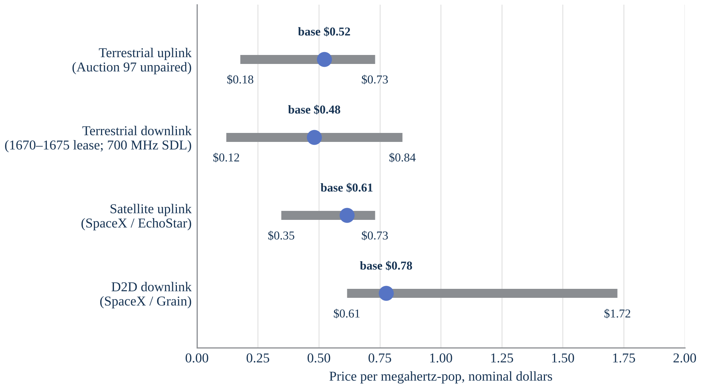
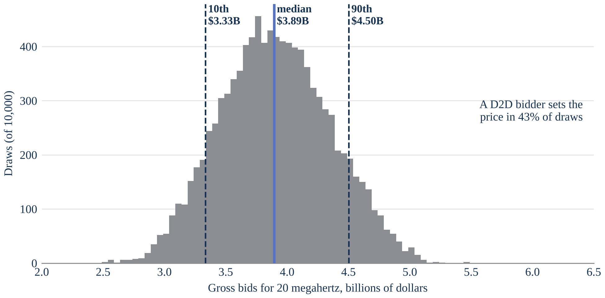
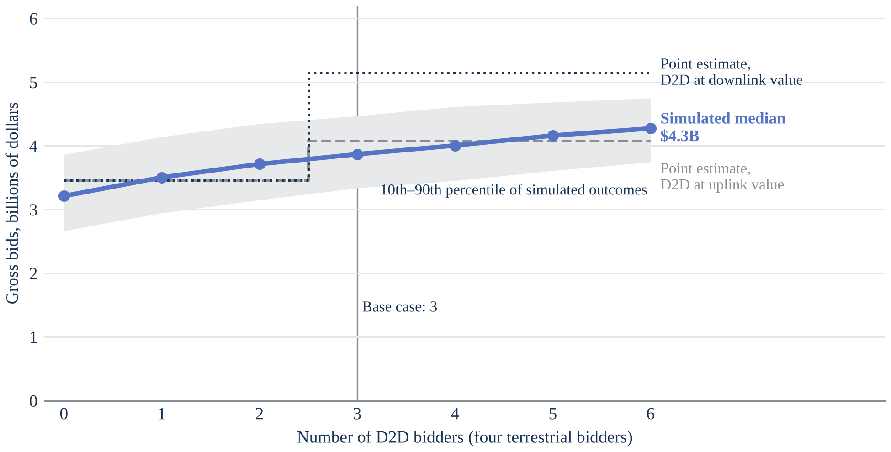
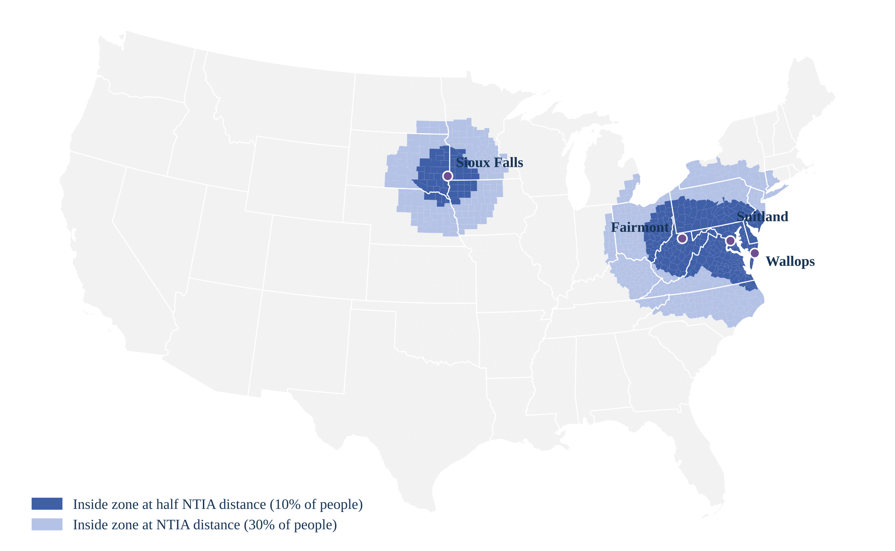
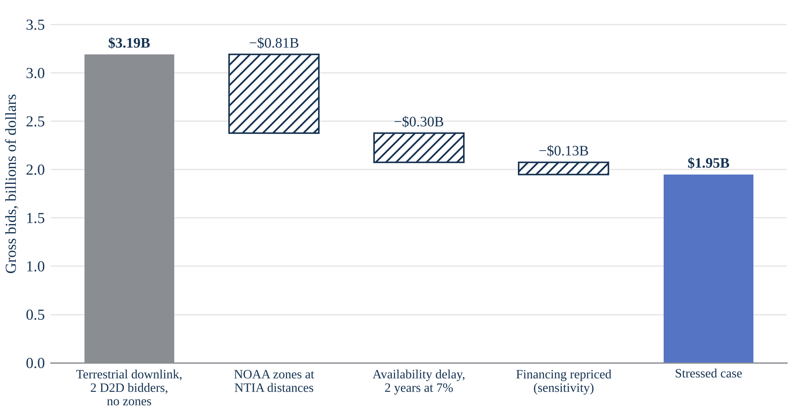
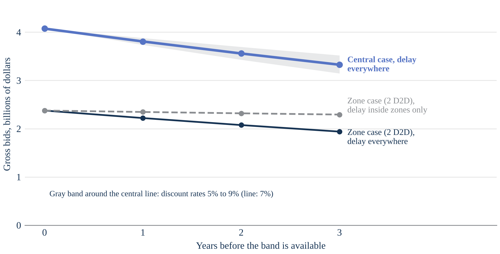

**DRAFT//PRE-DECISIONAL**

# Estimating auction revenue for 20 megahertz at 1675-1695 MHz: evidence, method, license design, and federal coordination

Working paper v0.6, November 17, 2026. Prepared with AI assistance. Reviewer: [CONFIRM]. Rule text as of: FCC 26-70, adopted October 29, 2026.

All dollar figures are *gross bids*, before any federal transition or sharing cost, for the two 10-megahertz blocks at 1675-1695 MHz. They aren't net revenue and can't be compared with net figures. The 2020-2025 MHz block in the same proposal is out of scope. The four National Oceanic and Atmospheric Administration (NOAA) coordination zones constrain terrestrial base-station downlink only; they don't affect uplink or direct-to-device (D2D) use. Section 6 models them.

Every range in this paper is conditional on stated assumptions. A range is not a confidence interval, and scenarios are not equally likely. Appendix A grades each assumption as observed, calibrated, or assumed.

## Executive summary

- **Central estimate: $4.1 billion.** In a simulation under the stated bidder-value assumptions, the middle 80 percent of outcomes falls between $3.3 and $4.5 billion. The NOAA zones don't change the central estimate, because D2D bidders set the price.
- **The FCC's own estimate is about four times higher.** Its regulatory impact analysis applies the Auction 113 average price, $2.53 per megahertz-pop, which is mostly paired spectrum. A megahertz-pop is one megahertz of spectrum for one person covered. Unpaired spectrum at 1695-1710 MHz sold for $0.52. That one choice accounts for $13.3 billion of the gap (Figure 6).
- **The number of D2D bidders matters most among the inputs we can't observe.** With three or more independent D2D bidders, they set the price. With two or fewer, revenue falls to $3.46 billion. The number of terrestrial bidders doesn't change the central estimate (Figures 7 and 8).
- **The NOAA zones reduce revenue only when terrestrial downlink bidders set the price.** At NTIA's coordination distances, 30 percent of the U.S. population is inside a zone. With three D2D bidders, the nationwide price doesn't change. With two or fewer, the zones cut revenue from $3.19 billion to $2.99 billion at half NTIA's distances and $2.38 billion at full distances (Figures 9-11).
- **Partial Economic Area (PEA) licenses with nationwide package bids protect value best.** They match or beat nationwide and PEA-only licensing in every case tested, with and without zones. With large zones, PEA-only licensing falls below nationwide, and package bids keep revenue at the nationwide level. This holds if at least three D2D bidders compete for packages (Figures 3 and 10).
- **Financing costs and delay are sensitivities, not part of the central case.** Repricing every benchmark to today's cost of capital lowers the central estimate by $0.20 billion; each year of delay at a 7 percent discount rate lowers it by about 6.5 percent. The 2026 auction data can't distinguish the financing adjustment from none (Figures 12-14).
- **A mid-band cross-check brackets the central estimate.** Starting from the 3.7 GHz and 3.45 GHz auctions and repricing them gives $3.71 to $4.65 billion, with band differences left unmodeled.

## 1. The question

The Further Notice of Proposed Rulemaking (FNPRM) of the Federal Communications Commission (FCC) proposes two unpaired 10-megahertz blocks, 1675-1685 MHz and 1685-1695 MHz, plus a 5-megahertz block at 2020-2025 MHz (para. 48).[1] Licensees could use the spectrum for uplink, downlink, or time-division duplex (para. 52). A secondary mobile-satellite allocation would allow supplemental coverage from space (SCS) (paras. 30-34).

The Commission seeks comment on three topics:

- Nationwide, Regional Economic Area Grouping (REAG), or PEA licenses, or different sizes by block (paras. 43-44, 51).
- Bundling and all-or-nothing nationwide package bids (paras. 75-78).
- Coordination zones around four NOAA Data Collection System (DCS) receive sites (paras. 101-102).

This paper asks what the 20 megahertz at 1675-1695 MHz could raise, which license design raises the most, and how much the NOAA zones cost. The National Telecommunications and Information Administration (NTIA) studied the coordination distances that the zone analysis uses.

## 2. Related literature

Bazelon and McHenry conclude that market sales are the starting point for valuing spectrum but need adjustment, and that a single valuation technique leaves information unused.[6] Budget estimates are coarser. The Congressional Budget Office scored the P.L. 119-21 auctions at $85.0 billion without valuing bands one by one.[7] Arner and Furchtgott-Roth applied megahertz-pop benchmarks with a 50 to 80 percent discount for limiting factors, including federal protection.[8] The FCC's own estimate for this proceeding applies one average price with a ±50 percent range.[1]

For the Advanced Wireless Services-3 (AWS-3) auction, Cramton and Sujarittanonta report the $2.72 paired and $0.52 unpaired prices that this paper reproduces. They also show that prices rose with market size.[3] Work on the PCS auctions found geographic synergies[9] and found that larger regional licenses would have raised efficiency.[10] Both findings support the national premium and the D2D exposure discount used here. Hazlett and Muñoz caution that revenue alone is a poor guide to allocation policy.[11] The pricing rule follows the theory of demand reduction in multi-unit auctions[12] and of package bidding and core pricing.[13]

The literature review found no published estimate of how much federal protection areas lower auction prices. Section 6 provides one, from the adjacent band's own auction. The full review is in `docs/literature-review.md`.

## 3. Evidence

**Auction 97 unpaired spectrum.** The FCC's Auction 97 results and inventory give a price for every license.[2] The paper parses all 1,614 licenses and reconciles them exactly to the published $41,329,673,325 in net bids and 1,611 licenses won. The unpaired 1695-1710 MHz blocks sold for $0.52 per megahertz-pop. The 10-megahertz B1 block sold for $0.73. Paired spectrum sold for $2.71, about five times the unpaired price.

**Market size.** Across 174 sold B1 licenses, the slope of log price on log population is 0.65 (R² = 0.59). Figure 2 shows the fit. Large markets paid more per person, which is why PEA licensing can raise more than one national price.

**Auction 113.** The 2026 auction raised $3,572,889,200 gross across 200 licenses, an average of $2.53 per megahertz-pop.[2] Only two licenses were unpaired; SpaceX won B1 in Cincinnati at $0.35. Across 196 licenses sold in both auctions, the 2026 price per person was 0.99 times the 2015 price. That ratio supports applying 2015 prices to current population.

**Transactions.** SpaceX agreed to buy EchoStar's unpaired AWS-3 licenses for about $2.6 billion in stock.[4] Adjusted for the 85 percent of population those licenses cover, that is $0.61 per megahertz-pop, 1.21 times the 2015 market-by-market price of the same licenses. For D2D downlink, the Grain 800 MHz spectrum was once on the market for $3.6 billion ($0.78) and reportedly sold to SpaceX for $8 billion ($1.72).[5]

**Unpaired downlink.** Two comparables restore terrestrial downlink, the use NTIA studied:[14]

- Qualcomm sold its unpaired Lower 700 MHz D and E Block licenses to AT&T for $1.925 billion for supplemental downlink. The FCC's approval order lists six megahertz nationwide and six more in five large Economic Areas. With 2010 populations, that is $0.84 per megahertz-pop.[15] It is low-band spectrum, so it is the ceiling.
- Crown Castle leased the adjacent 1670-1675 MHz nationwide license for $13 million a year in 2007.[16] Capitalized at the 7 percent rate the FCC uses (FNPRM App. C), that is $0.12 per megahertz-pop. It is the floor. FCC records didn't yield the 2003 auction price for that license.

Only the Qualcomm terms are verified in a primary filing. The other transaction terms come from releases and press reports and are flagged PENDING in the workbook.

## 4. Method

**Benchmarks.** Each use has a low, base, and high price (Figure 1):

| Use | Low | Base | High |
| --- | --- | --- | --- |
| Terrestrial uplink | $0.18 (B1 25th percentile) | $0.52 (Auction 97 unpaired) | $0.73 (B1) |
| Terrestrial downlink | $0.12 (1670-1675 lease) | $0.48 (average of the two) | $0.84 (Qualcomm 700 MHz) |
| Satellite uplink | $0.35 (Auction 113 B1) | $0.61 (EchoStar) | $0.73 (B1) |
| D2D downlink | $0.61 (EchoStar) | $0.78 (Grain prior market) | $1.72 (Grain to SpaceX) |

**Bidders.** The model uses counts, not a named list: three D2D bidders and four terrestrial bidders in the base case, varied from zero to six in section 5.2.

**Pricing.** With two blocks in a uniform-price clock auction, the price per block is the highest losing bid, which is the third-highest bid. One D2D bidder may want both blocks. It bids for two only if that leaves it more surplus (demand reduction). Revenue is the price times two blocks.

**License areas.** Under PEA licensing, each of 406 contiguous PEAs plus a combined Alaska and Hawaii market is its own auction. Terrestrial values by PEA follow the fitted market-size curve. D2D per-PEA bids lose the 1.21 national premium. With package bidding, a nationwide package wins a block only if it beats the sum of the per-PEA bids, and it pays at least that sum.

**Coordination zones.** A county's 2020 population-weighted center is inside a zone if it lies within the coordination distance of one of the four sites. NTIA's distances (Fairmont 459 km, Sioux Falls 346 km, Suitland 468 km, Wallops 446 km) come from its 2024 study, which NTIA calls conservative.[17] Zones scale from 0 to 100 percent of those distances. The zones apply to terrestrial base-station downlink only. Inside a zone, a terrestrial bidder that values the band as downlink keeps a fraction of its value, calibrated in section 6.2. Uplink and D2D values don't change.

**Zone-free market-size curve.** The Auction 97 B1 prices already include the effect of AWS-3 protection zones in 19 of 172 markets, mostly large Northeast markets. Applying the 1675-1695 MHz zones to that curve would count part of the effect twice. The zone analysis therefore uses a curve fitted with the AWS-3 zone share held in the regression (section 6.2). The headline benchmarks stay as observed.

**Financing and timing.** Two sensitivities sit outside the central case. The financing sensitivity reprices each benchmark from its own date to today's cost of capital, using the ratio of 15-year annuity factors. The timing sensitivity delays availability by 0 to 3 years, which multiplies value by (1 + r)^-d. Section 7 describes both.

**Independent implementation.** A separate Python implementation recomputes the benchmarks from the FCC data. It reproduces every workbook scenario and license-design result to within one cent before it runs the analyses in sections 5 to 7. The workbook holds the central model. The zone, financing, timing, and mid-band analyses run in the Python layer only.

## 5. Results before coordination

### 5.1 Central estimate and range

The central case (three D2D bidders valuing the band as satellite uplink) raises $4.07 billion. If D2D bidders value it as downlink, revenue is $5.14 billion. With two D2D bidders, or if D2D operators lease SCS rights instead of bidding, revenue is $3.46 billion. If terrestrial bidders value the band as downlink, revenue doesn't change, because D2D bidders still set the price.

The low and high benchmark cases bracket the result at $2.29 and $11.43 billion (Figure 4). The high case rests on a low-band price. The simulation in Figure 5 adds a spread under assumptions about each bidder's value, so its percentiles are conditional on those assumptions.

### 5.2 Number of bidders

The point estimate steps from $3.46 billion to $4.07 billion (uplink value) or $5.14 billion (downlink value) when a third D2D bidder enters. In the simulation, which spreads each bidder's value, the median rises smoothly. It goes from $3.21 billion with no D2D bidders to $3.87 billion with three and $4.27 billion with six (Figure 7). Varying terrestrial bidders from two to six doesn't change the central estimate.

### 5.3 Why the FCC's estimate is higher

The FCC estimates $21.2 billion for all 25 megahertz ($10.6 to $31.8 billion), using the Auction 113 average of $2.53 per megahertz-pop.[1] The FCC data reproduce that average ($2.527). Scaled to 20 megahertz, the FCC method gives $17.0 billion.

Moving to the 2020 Census population subtracts $0.2 billion. Pricing unpaired spectrum at the unpaired price subtracts $13.3 billion. The auction rule with three D2D bidders adds $0.6 billion, which leaves $4.1 billion (Figure 6). The NOAA zones don't change the central case. Paired licenses were 98 percent of the megahertz-pops sold in Auction 113, and paired spectrum sold for five times unpaired spectrum in Auction 97.

### 5.4 License design

Gross bids before coordination, billions of dollars:

| Design | UE uplink | D2D downlink | Lowest case tested (uplink / downlink) |
| --- | --- | --- | --- |
| 1. Nationwide | 4.07 | 5.14 | 4.07 / 5.14 |
| 2. PEA only | 4.65 | 5.21 | 3.46 / 4.24 |
| 3. PEA with nationwide packages | 4.65 | 5.21 | 4.07 / 5.14 |

Here, UE means user equipment, such as handsets. Terrestrial bidders win the 13 largest PEAs under PEA licensing, and D2D bidders win the rest. PEA-only licensing loses its advantage if price per person is flat across market sizes or if D2D bidders discount for exposure risk. Package bids cover that weakness (Figure 3).

### 5.5 Stress tests

- **Package bids need D2D competition.** With three or more D2D bidders, packages are safe. With one or two, a package can win at the local bidders' price. If local bidders mount only 80 percent of their combined value (the threshold problem), revenue falls from $3.46 billion to $2.77 billion.
- **Adjacency and demand reduction.** An adjacency premium alone doesn't change the price, because the third-highest bid sets it. It matters only if it makes the lead bidder bid for both blocks. With two D2D bidders, that happens in either of two cases: the lead values the second block at 1.2 times the first and holds a premium of 21 percent or more, or the lead holds a premium of 50 percent. Revenue then rises from $3.46 billion to $5.14 billion.
- **Income check.** At the FCC's 7 percent rate over the proposed 15-year term (para. 56), the central price implies $1.35 per person per year for 20 megahertz, about $0.11 a month. The D2D downlink price implies $1.70 a year.

### 5.6 Backtest

Fitting the market-size curve on random halves of the Auction 97 B1 licenses and predicting the other half gives a median error of 49 percent per license, against 401 percent for one national price. The error in total hold-out revenue has a median of 0.2 percent (10th to 90th percentile: -24 to +30 percent). Out of sample, the 2015 curve predicted SpaceX's 2026 Cincinnati B1 price within 19 percent. It missed the one 5-megahertz A1 license by 79 percent.

### 5.7 From the FCC's method to the central case, stage by stage

Table 1 shows the price and revenue after each stage, in two stage orders. The attribution of the first two stages depends on the order, because population and price multiply. The total doesn't.

| Stage | Price after ($ per megahertz-pop) | Revenue after, population first ($B) | Change, population first ($B) | Change, price first ($B) |
| --- | --- | --- | --- | --- |
| FCC method, 20 MHz | 2.53 | 16.95 | - | - |
| 2020 Census population | 2.53 | 16.77 | -0.18 | -0.04 (second) |
| Unpaired price (Auction 97) | 0.52 | 3.46 | -13.31 | -13.46 (first) |
| Auction rule, 3 D2D bidders | 0.61 | 4.07 | +0.61 | +0.61 |
| NOAA zones | 0.61 | 4.07 | 0.00 | 0.00 |
| Availability delay (0 years) | 0.61 | 4.07 | 0.00 | 0.00 |
| Financing (not applied) | 0.61 | 4.07 | 0.00 | 0.00 |

*Table 1. Stage table for the central case. Source: `stage_table.csv`.*

Figure 12 applies the same stage logic to a stressed case: terrestrial downlink bidders set the price with two D2D bidders. Full NTIA zones, a 2-year delay at 7 percent, and financing repriced to today's cost of capital take revenue from $3.19 to $1.95 billion.

## 6. Federal coordination

### 6.1 How far the zones reach

The zone model reproduces NTIA's own population results for the 25 largest PEAs to within 0.1 percentage point on average, and it agrees on all 25. At NTIA's distances, the four zones cover 30 percent of the U.S. population, including nearly all of the New York, Baltimore-Washington, Philadelphia, Cleveland, and Pittsburgh PEAs. At half those distances they cover 10 percent. At a quarter, they cover 4 percent (Figure 9).

### 6.2 What a zone costs: evidence from AWS-3

The adjacent 1695-1710 MHz licenses sold in Auction 97 with 27 federal earth station protection zones (47 CFR 2.106, footnote US88). Regressing each B1 license's log price on log population and on the share of its population inside a zone gives a coefficient of -1.03 (standard error 0.24). The regression covers 172 markets, 19 of them with zones. A fully covered market sold for about 36 percent of the market-size expectation (95 percent range: 22 to 57 percent; Figure 11).

Dropping Baltimore-Washington strengthens the effect (-1.20), and an any-zone indicator gives prices 49 percent lower. The estimate rests on 19 markets, mostly partly covered, and on a bidder pool dominated by Dish-affiliated entities. It is a calibration, not a precise measurement.

The same regression gives a market-size elasticity of 0.67 with the zone effect held out, against 0.65 without. Revenue-weighted, the observed B1 prices are 91 percent of their zone-free level, so the zone-free terrestrial uplink base is about $0.57 instead of $0.52. Using the zone-free curve changes the zone results by 1 percent or less and leaves the central estimate unchanged. As a sensitivity, PEA licensing with the zone-free curve and base raises $4.94 billion for UE uplink and $5.49 billion for D2D downlink, against $4.65 and $5.21 billion on the observed curve.

### 6.3 Revenue with zones

The zones apply only where terrestrial bidders value the band as downlink. The 1675-1680 MHz identification and the FNPRM's coordination proposal both concern terrestrial base stations.[1][14] The tables use terrestrial downlink values ($0.48 base), D2D bidders at the satellite uplink value, the zone-free curve, and 36 percent of value kept inside zones.

With three D2D bidders, gross bids in billions of dollars:

| Zone radius | Nationwide | PEA only | PEA + packages |
| --- | --- | --- | --- |
| None | 4.07 | 4.48 | 4.48 |
| Half NTIA distance | 4.07 | 4.41 | 4.41 |
| NTIA distance | 4.07 | 3.91 | 4.07 |

With two D2D bidders, all license designs give the same result: $3.19 billion with no zones, $2.99 billion at half NTIA's distance, and $2.38 billion at NTIA's distance.

With three D2D bidders, D2D bids set the nationwide price, so the zones don't reduce it. Under PEA licensing, terrestrial bidders win the large Northeast markets, and large zones cut what they bid there. PEA-only revenue falls below nationwide at about 75 percent of NTIA's distances, while package bids keep revenue at the nationwide level (Figure 10). With two or fewer D2D bidders, terrestrial downlink bidders set the price everywhere. The zones then cost $0.2 billion at half NTIA's distances and $0.8 billion at full distances.

### 6.4 Cross-check of the zone discount

A second estimate builds the value kept inside a zone from six assumed factors: usable bandwidth, site approval, technical performance, coordination timing, rule certainty, and reuse of existing sites. Central values give a product of 43 percent, with a range of 18 to 90 percent. The calibrated value is 36 percent, with a 95 percent range of 22 to 57 percent. The two central estimates are close and the assumed one falls inside the calibrated interval, but the factors have no public measurement behind them. The paper keeps the calibrated value as the central input (Appendix A).

## 7. Financing, timing, and a mid-band cross-check

### 7.1 Financing conditions

Auction prices set when financing was cheaper might overstate what bidders would pay at today's rates. The paper tests this instead of assuming it. It computes a weighted average cost of capital (WACC) at each benchmark's date from public Treasury and Baa corporate yields, with assumed capital-structure inputs (Appendix A). It then takes the ratio of 15-year annuity factors at today's rate and at the benchmark's rate.

Today's WACC is 7.45 percent. At Auction 97 it was 5.14 percent, which gives a factor of 0.86. The test asks whether the 2026 prices of the same licenses look like the 2015 prices times 0.86. They don't clearly differ from either: the observed ratio is 0.99, with a bootstrap interval of 0.82 to 1.72, and 0.86 lies inside it. The data can't separate a financing adjustment from none, so it stays a sensitivity.

Repricing every benchmark to today's financing lowers the central estimate by $0.20 billion (5 percent), to $3.88 billion. The two-D2D-bidder case falls from $3.46 to $2.98 billion, because it rests on the 2015 terrestrial benchmark (Figure 8).

### 7.2 Availability timing

If the band becomes available d years after the auction, value falls by the factor (1 + r)^-d. At 7 percent, one, two, and three years of delay cut the central estimate from $4.07 billion to $3.81, $3.56, and $3.33 billion (Figure 13). If only areas inside the zones are delayed, the central estimate doesn't change, and the stressed zone case falls by about $0.03 billion a year. No public schedule for clearing federal operations from the band is available, so the delay is a sensitivity. A schedule would replace the parameter.

### 7.3 Mid-band cross-check

The FCC data for Auctions 107 (3.7 GHz) and 110 (3.45 GHz) reconcile to their published totals of about $81.17 billion and $22.5 billion in gross bids.[2] On the 2020 Census population of the 406 PEAs, they sold at $0.88 and $0.68 per megahertz-pop. Repricing each to today's financing gives $0.70 and $0.56. For 20 megahertz and the 2020 population, that is $4.65 billion from the 3.7 GHz anchor and $3.71 billion from the 3.45 GHz anchor.

The second figure equals the first with a market-perception adjustment, because the later auction priced the same kind of spectrum lower. The central estimate of $4.07 billion sits between them. The method doesn't scale value by coverage area, which would raise the value of a lower band several times over, contrary to the low-band evidence. It leaves differences between mid-band and 1.7 GHz unpaired spectrum unmodeled, so it is a cross-check, not an estimate.

## 8. What the model doesn't capture

Realized proceeds will also depend on which bidders participate, their strategies, their willingness to take on debt, the timing of other spectrum offerings, and the final rules. New entrants could raise competition and proceeds. The bidder-count sweep (Figure 7) is the quantitative handle on participation.

Other offerings in the same window, from public notices:

- **Auction 115, the upper C-band.** Bidding starts on April 27, 2027, for 160 megahertz at 3.98-4.14 GHz.[18]
- **Statutory deadline.** The One Big Beautiful Bill Act requires an auction of at least 100 megahertz by July 4, 2027. It restores FCC auction authority through 2034 and directs auctions totaling at least 300 megahertz by 2034.[19]

Bidders with large mid-band commitments could have less capacity for spectrum at 1675-1695 MHz. The paper doesn't model budget limits.

## 9. Limitations

- **Zone size.** NTIA calls its distances conservative, and the FCC asks whether deployment-based assumptions should replace them (para. 102). The result spans half to full NTIA distances; smaller zones cost less.
- **Zone cost calibration.** It comes from 19 partly covered AWS-3 markets, where federal protection zones constrained terrestrial base stations. The paper applies it to terrestrial downlink only.
- **Bidder counts.** The headline assumes three D2D bidders. With two, the point estimate falls by $0.6 billion.
- **Transactions.** EchoStar, Grain, and the 1670-1675 MHz lease come from releases and press reports. Only the Qualcomm sale is verified in an FCC order.
- **Financing and timing.** Both are sensitivities. The capital-structure inputs are assumed, and no public clearing schedule exists.
- **Mid-band cross-check.** It ignores differences in band, use, and encumbrance.
- **Not modeled.** 2020-2025 MHz, REAG licenses, alternative band plans, bidding credits, and bidder budgets.

## 10. Reproducing this paper

Run `./reproduce.sh`. The script does the following:

1. Downloads or checks every source file.
2. Parses the source files.
3. Builds and recalculates the workbook, then verifies it.
4. Exports every dataset to `data/csv/`.
5. Runs the independent analyses.
6. Rebuilds every figure.

| Item | Location |
| --- | --- |
| Workbook | `outputs/1675-auction-valuation-v0.5.xlsx` |
| Datasets | `data/csv/` (descriptions in `data/csv/README.md`) |
| Analyses | `scripts/analysis.py` |
| Figure code | `scripts/make_figures.py`, `scripts/briefing.mplstyle` |
| Figures (PNG, SVG, PDF) | `figures/` |
| Visualization plan | `docs/dataviz-plan.md` |
| Literature review | `docs/literature-review.md` |
| Plan for this version | `docs/7ghz-method-lessons-plan.md` |

## Appendix A. Assumptions register

Evidence grades: *observed* means measured in public data; *calibrated* means fitted to public data; *assumed* means set by judgment with no public measurement. Each row names the file that holds it.

| Input | Value | Basis | Grade | File |
| --- | --- | --- | --- | --- |
| Terrestrial uplink base | $0.52 | Auction 97 unpaired average | Observed | `benchmarks.csv` |
| Satellite uplink base | $0.61 | EchoStar sale over 85% of population | Observed | `benchmarks.csv` |
| D2D downlink base | $0.78 | Grain prior market value | Observed (press) | `benchmarks.csv` |
| Terrestrial downlink base | $0.48 | Average of lease and Qualcomm sale | Observed | `benchmarks.csv` |
| Flat-nominal price ratio, 2026 to 2015 | 0.99 | 196 licenses in Auctions 97 and 113 | Observed | `financing_test.csv` |
| National premium for D2D | 1.21 | Calibrated to the EchoStar price | Calibrated | `inputs.csv` |
| Market-size elasticity | 0.65 (0.67 zone-free) | B1 licenses | Calibrated | `zone_free_curve.csv` |
| Value kept inside a zone | 36% (22%-57%) | Auction 97 on AWS-3 zones | Calibrated | `analysis_summary.csv` |
| NOAA distances | 459, 346, 468, 446 km | NTIA Report 24-01, Table 9 | Observed | `ntia_zone_validation.csv` |
| Carrier value spread | 0.238 | Auction 97 paired winners over $1 billion | Calibrated | `monte_carlo_summary.csv` |
| D2D value in simulation | Uniform, EchoStar to Grain price | Spread of D2D comparables | Assumed | `monte_carlo_summary.csv` |
| D2D and terrestrial bidders | 3 and 4 | No named bidder list | Assumed | `bidder_count_grid.csv` |
| Discount rate and license term | 7%, 15 years | FNPRM App. C and para. 56 | Observed (FCC) | `income_check.csv` |
| Debt share, equity beta, equity risk premium | 40%, 0.80, 5% | Typical ranges; replace with sourced figures | Assumed | `financing_wacc.csv` |
| Tax rate | 21% | U.S. federal statutory rate | Observed | `financing_wacc.csv` |
| Six zone factors | See file | Illustrative ranges | Assumed | `zone_structural.csv` |
| Availability delay | 0 to 3 years | No public clearing schedule | Assumed | `timing_sensitivity.csv` |

## Numbers ledger

| Figure | Exact value | Source file | Rounded form |
| --- | --- | --- | --- |
| Central case (S1) | $4,073,638,216 | `scenarios.csv` | $4.07 billion ($4.1 billion in summaries) |
| D2D downlink value (S2) | $5,142,857,143 | `scenarios.csv` | $5.14 billion |
| Two D2D bidders or SCS lease (S3, S8) | $3,460,286,484 | `scenarios.csv` | $3.46 billion |
| Low and high cases (S6, S7) | $2,291,684,702; $11,428,571,429 | `scenarios.csv` | $2.29 and $11.43 billion |
| PEA (+ packages), uplink and downlink | $4,649,631,172; $5,212,968,610 | `license_area_results.csv` | $4.65 and $5.21 billion |
| Simulated 10th percentile, median, 90th | $3.33, $3.89, $4.50 billion | `monte_carlo_draws.csv` | same |
| FCC estimate, 25 and 20 MHz | $21.19 and $16.96 billion | `fcc_ria_comparison.csv` | $21.2 and $17.0 billion |
| Population inside zones at NTIA, half distance | 29.5%, 10.3% | `zone_sweep.csv` | 30%, 10% |
| Value kept in a fully covered market | 35.7% (22.4%-57.0%) | `analysis_summary.csv` | 36% |
| Terrestrial downlink, 2 D2D: no zones, half, full NTIA distance | $3,190 million; $2,989 million; $2,376 million | `zone_sweep.csv` | $3.19, $2.99, $2.38 billion |
| PEA only, 3 D2D: no zones, half, full NTIA distance | $4,476 million; $4,405 million; $3,908 million | `zone_sweep.csv` | $4.48, $4.41, $3.91 billion |
| Zone-free uplift of the Auction 97 benchmark | 1.0995 | `zone_free_curve.csv` | about 10% ($0.52 to $0.57) |
| WACC today; at Auction 97 | 7.45%; 5.14% | `financing_wacc.csv` | 7.45%; 5.14% |
| Financing factor, Auction 97 to today | 0.8610 | `financing_wacc.csv` | 0.86 |
| Central estimate repriced to today's financing | $3,875,500,830 | `financing_sensitivity.csv` | $3.88 billion |
| Central estimate with delay of 1, 2, 3 years at 7% | $3,807 million; $3,558 million; $3,325 million | `timing_sensitivity.csv` | $3.81, $3.56, $3.33 billion |
| Stressed case after zones, delay, financing | $1,948,356,389 | `stage_table.csv` | $1.95 billion |
| Mid-band cross-check, 3.7 GHz and 3.45 GHz anchors | $4,648,840,434; $3,710,015,431 | `midband_crosscheck.csv` | $4.65 and $3.71 billion |
| Value kept inside a zone, assumed factors | 42.8% (18.0%-90.2%) | `zone_structural.csv` | 43% (18%-90%) |
| Qualcomm 700 MHz; 1670-1675 lease | $0.842; $0.120 per MHz-pop | `transactions.csv` | $0.84; $0.12 |

## Figures

Captions use the figure title as the takeaway. Each figure's alternative text is embedded in the figure file and in the Word version.

**Figure 1. Benchmark prices by use.** Price per megahertz-pop; bars show low to high, dots the base case. Source: FCC Auctions 97 and 113, FCC 11-188, and reported transactions (`data/csv/benchmarks.csv`).

**Figure 2. In Auction 97, price per person rose with market size.** 174 B1 licenses; fitted slope 0.65; log axes. Source: FCC DA 15-131 (`a97_unpaired_licenses.csv`).

**Figure 3. PEA licenses with package bids match or beat the other designs.** Bars are base-case gross bids; ticks mark the lowest case tested. Source: workbook v0.5 (`license_area_results.csv`).

**Figure 4. Scenario results before coordination.** Source: workbook v0.5 (`scenarios.csv`).

**Figure 5. Simulated gross bids center near $3.9 billion.** 10,000 draws, seed 1675; three D2D and four terrestrial bidders; conditional on the assumed bidder-value distributions. Source: `monte_carlo_draws.csv`.

**Figure 6. The FCC's estimate is higher mainly because it prices unpaired spectrum like paired spectrum.** Bridge from the FCC's method scaled to 20 megahertz to this paper's central estimate. Source: FNPRM App. C and `fcc_ria_comparison.csv`.

**Figure 7. A third D2D bidder raises the point estimate; the simulated median rises steadily.** Four terrestrial bidders; band is the 10th to 90th percentile of 2,000 draws per point. Source: `bidder_count_grid.csv`.

**Figure 8. D2D valuation and the benchmarks move the central estimate most; NOAA zones and terrestrial bidder count don't.** One input at a time from the $4.07 billion central case. Source: `tornado.csv`.

**Figure 9. At NTIA's distances, the four NOAA zones would cover 30 percent of the population.** Counties whose population center is within the coordination distance. Source: NTIA Report 24-01, Census 2020 (`zone_counties.csv`).

**Figure 10. Zones reduce revenue when terrestrial downlink sets the price.** Revenue by zone radius with terrestrial bidders valuing the band as downlink, D2D bidders at the satellite uplink value, the zone-free curve, and 36 percent of value kept inside zones. Source: `zone_sweep.csv`.

**Figure 11. AWS-3 protection zones lowered Auction 97 prices.** Price relative to the market-size expectation against the share of population inside 47 CFR 2.106 US88 zones; line is the regression fit. Source: `aws3_zone_calibration.csv`.

**Figure 12. In a stressed case, zones, delay, and financing take revenue from $3.19 to $1.95 billion.** Terrestrial downlink with two D2D bidders; zones at NTIA distances; a 2-year delay at 7 percent; financing repriced to today's cost of capital. Source: `stage_table.csv`.

**Figure 13. Each year of delay lowers the central estimate by about 6.5 percent.** Discount rate 7 percent; band shows 5 to 9 percent. Delay inside the zones only barely moves the zone case. Source: `timing_sensitivity.csv`.

**Figure 14. Most methods bracket the central estimate; the FCC's range lies far above it.** Each bar is a conditional range from one method; the tick marks the central or median value. Source: `scenarios.csv`, `monte_carlo_draws.csv`, `midband_crosscheck.csv`, `timing_sensitivity.csv`, `financing_sensitivity.csv`, and `fcc_ria_comparison.csv`.

## Sources

1. FCC, *Auctioning the 1675-1695 MHz and 2020-2025 MHz Bands*, Further Notice of Proposed Rulemaking, FCC 26-70, WT Docket No. 26-284 (adopted Oct. 29, 2026), paras. 30-34, 43-56, 75-78, 101-102, and App. C ([FCC 26-70](https://docs.fcc.gov/public/attachments/FCC-26-70A1.pdf)).
2. FCC, [DA 15-131](https://docs.fcc.gov/public/attachments/DA-15-131A2.pdf) and [DA 14-1018](https://docs.fcc.gov/public/attachments/DA-14-1018A2.pdf) (Auction 97); [DA 26-633](https://docs.fcc.gov/public/attachments/DA-26-633A1.pdf) and [Auction 113 results by license](https://auctiondata.fcc.gov/public/projects/auction113/reports/results_by_license); [Auction 107 results by license](https://auctiondata.fcc.gov/public/projects/auction107/reports/results_by_license) and [Auction 110 results by license](https://auctiondata.fcc.gov/public/projects/auction110/reports/results_by_license); [DA 14-759](https://docs.fcc.gov/public/attachments/DA-14-759A3.pdf) (PEA definitions). Checksums in `data/SOURCES.md`.
3. Peter Cramton and Pacharasut Sujarittanonta, ["Bidding and Prices in the AWS-3 Auction"](https://www.mintic.gov.co/portal/historico/articles-103102_avantel_anexo_d_3_cramtonaws3auctionprices.pdf) (May 2015).
4. EchoStar, ["EchoStar Agrees to Sell Full Unpaired AWS-3 Spectrum License"](https://ir.echostar.com/news-releases/news-release-details/echostar-agrees-sell-full-unpaired-aws-3-spectrum-license) (Nov. 6, 2025).
5. Fierce Network, ["SpaceX's 800 MHz spectrum grab threatens Big 3 mobile carriers"](https://www.fierce-network.com/wireless/spacexs-800-mhz-spectrum-grab-threatens-big-3-mobile-carriers); the $8 billion figure is as reported by the Wall Street Journal.
6. Coleman Bazelon and Giulia McHenry, ["Spectrum value,"](https://econpapers.repec.org/RePEc:eee:telpol:v:37:y:2013:i:9:p:737-747) *Telecommunications Policy* 37(9) (2013): 737-747.
7. CBO, [supplemental cost estimate for P.L. 119-21, Sec. 40002](https://www.cbo.gov/system/files/2025-10/PL%20119-21-Spectrum.pdf) (Oct. 28, 2025).
8. Kirk R. Arner and Harold Furchtgott-Roth, ["Estimated Value of Potential Spectrum Auction Receipts in the Next Five-Year Window,"](https://hudson.org/technology/estimated-value-potential-spectrum-auction-receipts-next-five-year-window-kirk-arner-harold-furchtgott-roth) Hudson Institute (July 18, 2024).
9. Ausubel, Cramton, McAfee, and McMillan, "Synergies in Wireless Telephony," *Journal of Economics & Management Strategy* 6(3) (1997): 497-527.
10. Jeremy T. Fox and Patrick Bajari, "Measuring the Efficiency of an FCC Spectrum Auction," *American Economic Journal: Microeconomics* 5(1) (2013): 100-146.
11. Thomas W. Hazlett and Roberto E. Muñoz, "A welfare analysis of spectrum allocation policies," *RAND Journal of Economics* 40(3) (2009): 424-454.
12. Ausubel, Cramton, Pycia, Rostek, and Weretka, "Demand Reduction and Inefficiency in Multi-Unit Auctions," *Review of Economic Studies* 81(4) (2014): 1366-1400.
13. Goeree and Holt, "Hierarchical package bidding," *Games and Economic Behavior* 70(1) (2010): 146-169; Day and Milgrom, "Core-selecting package auctions," *International Journal of Game Theory* 36 (2008): 393-407.
14. NTIA, [letter to FCC Chairman Brendan Carr identifying 1675-1680 MHz](https://www.ntia.gov/sites/default/files/2026-03/1675-mhz-identification-letter.pdf) (Feb. 26, 2026).
15. FCC, *Application of AT&T Inc. and Qualcomm Incorporated*, Order, [FCC 11-188](https://docs.fcc.gov/public/attachments/FCC-11-188A1.pdf) (Dec. 22, 2011), paras. 1, 15.
16. TV Technology, ["Crown Castle Leasing Modeo Spectrum for $13 Million Per Year"](https://www.tvtechnology.com/news/crown-castle-leasing-modeo-spectrum-for-13-million-per-year) (July 27, 2007).
17. NTIA Report 24-01, [*Spectrum Pipeline Reallocation Engineering Study Follow-On*](https://www.ntia.gov/sites/default/files/2025-10/ntia_report_24-01_12-2024-1675mhz-rev3-ntia-spres-fo.pdf) (Dec. 2024), Tables 3, 9, and 11; 47 CFR 2.106(c)(88) (eCFR, Nov. 1, 2026).
18. Light Reading, ["FCC sets key dates for upper C-band auction"](https://www.lightreading.com/regulatory-politics/fcc-sets-key-dates-for-upper-c-band-auction) (Nov. 13, 2026).
19. Phillips Lytle, ["FCC Advances Upper C-Band Auction Under Tight Statutory Timeline"](https://phillipslytle.com/fcc-advances-upper-c-band-auction-under-tight-statutory-timeline-july-4-2027/clientalert-telecom-5g-2026-06-23-mobile/) (June 23, 2026).
20. Federal Reserve Bank of St. Louis, FRED series [DGS10](https://fred.stlouisfed.org/series/DGS10) (10-year Treasury yield) and [DBAA](https://fred.stlouisfed.org/series/DBAA) (Moody's Baa corporate yield); snapshots dated November 13, 2026 in `data/raw/fred/`.

**DRAFT//PRE-DECISIONAL**
